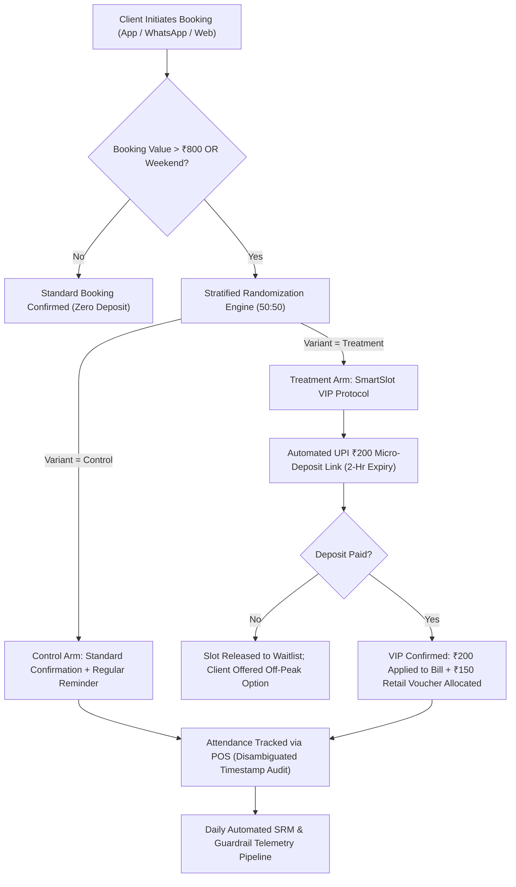

# EXPERIMENT DESIGN DOCUMENT: "SMARTSLOT VIP" DYNAMIC DEPOSIT & CONCIERGE PROTOCOL
**Company:** Kongu Aura Wellness & Salon Chain (22 Outlets across Greater Coimbatore & Western Tamil Nadu)  
**Document Version:** 1.0 (Production Release)  
**Author:** Lead Econometrician & Experimentation Platform Lead  
**Target Execution Window:** Q4 (6 Weeks)  
**Status:** Validated & Approved for Implementation  

---

## 1. Executive Summary & Problem Formulation

### 1.1 Business Context
Kongu Aura operates 22 salon and wellness spas across Coimbatore (R.S. Puram, Gandhipuram, Race Course, Peelamedu, Saravanampatti, etc.) and neighboring western Tamil Nadu industrial hubs (Tirupur, Erode). Across its network, the chain processes approximately 25,000 to 28,000 client bookings monthly (~300,000 annually). 

### 1.2 The Core Problem: Ghost Chairs & Chronic No-Shows
Salon profitability is fundamentally governed by **chair utilization** ($Hours\ Serviced / Hours\ Available$). An audit of 300,000 historical records reveals:
- **True No-Show Rate:** **14.88%** of all scheduled appointments (44,022 appointments annually).
- **The "Disguised Cancellation" Phenomenon:** Of all true no-shows, **65% (28,888 cases) are misrecorded as "CANCELLATION"** because receptionists clear overdue calendar slots with the cancel button. Only 5.04% are explicitly tagged as `NO_SHOW`.
- **Financial Leakage:** A missed slot leaves stylists idle while turning away walk-in footfall, resulting in an estimated revenue loss of **₹11.6 Crore annually** across the 22 outlets.

### 1.3 The Proposed Business Initiative: "SmartSlot VIP"
To eliminate ghost chairs while maximizing customer lifetime value, Kongu Aura has engineered **SmartSlot VIP**:
1. **Dynamic Micro-Deposit:** High-ticket bookings (>₹800) or peak weekend slots require a refundable/applicable micro-deposit of ₹200 collected via automated UPI WhatsApp link.
2. **Value-Add Concierge Voucher:** Upon timely arrival, the client receives their ₹200 applied to the service bill PLUS an instant ₹150 **Retail & Add-On Voucher** redeemable on retail shelves (shampoos, serums) or add-on express therapies.
3. **Priority Chair Guarantee:** Dedicated VIP station allocation ensuring zero wait-time.

---

## 2. Hypothesis Formulation

### 2.1 Primary Hypothesis
* **Null Hypothesis ($H_0$):** The SmartSlot VIP protocol produces no change or a negative change in Net Realized Revenue Per Visit ($\Delta \mu_{RPV} \le 0$) and does not reduce the True No-Show Rate ($\Delta p_{noshow} \ge 0$).
  $$H_0: \mu_{T, RPV} - \mu_{C, RPV} \le 0 \quad \text{and} \quad p_{T, noshow} - p_{C, noshow} \ge 0$$
* **Alternative Hypothesis ($H_1$):** The SmartSlot VIP protocol statistically significantly increases Net Realized Revenue Per Visit ($\Delta \mu_{RPV} > 0$) while reducing the True No-Show Rate ($\Delta p_{noshow} < 0$).
  $$H_1: \mu_{T, RPV} - \mu_{C, RPV} > 0 \quad \text{and} \quad p_{T, noshow} - p_{C, noshow} < 0$$

---

## 3. Metric Architecture & Selection Justification

### 3.1 Primary Metric: Net Revenue Per Visit (RPV, INR)
* **Definition:** Total realized bill amount (services performed + retail take-home products) divided by total booked appointments within the experimental window:
  $$RPV = \frac{\sum_{i=1}^N (ServiceSpend_i + ProductSpend_i)}{N_{Booked}}$$
* **Justification against Alternatives:**
  1. *Client 60-Day Retention Rate:* While crucial for long-term customer equity, 60-day retention requires an observation lag of 8–12 weeks post-experiment, delaying business decisions. It is also susceptible to exogenous macroeconomic noise (festive cycles).
  2. *True No-Show Rate:* A vital operational efficiency metric, but optimizing for no-show reduction alone could theoretically harm the business if deposit friction causes a drastic collapse in total bookings.
  3. *Why RPV Wins:* RPV accounts for both attendance realization and basket expansion (retail voucher utilization). A missed appointment records ₹0 spend, directly penalizing no-shows in the expectation:
     $$\mathbb{E}[RPV] = (1 - P_{noshow}) \times \mathbb{E}[Spend \mid Attended]$$

### 3.2 Co-Primary / Operational Metric
* **True No-Show Rate (%):** Proportion of booked appointments where the client failed to arrive (including disguised cancellations occurring within 60 minutes of the slot).

### 3.3 Guardrail Metrics (Safety Boundaries)
Guardrail metrics must not breach predetermined tolerance boundaries; any breach triggers an immediate operational freeze:
1. **Total Booking Volume (Friction Check):** Weekly booking count per outlet must not drop by more than **-3.0%** ($H_0: \Delta Volume < -3\%$).
2. **Walk-in Chair Conversion Rate:** Proportion of walk-in patrons seated within 15 minutes must remain $\ge 75\%$.
3. **Customer Satisfaction (CSAT / NPS):** Post-service WhatsApp CSAT rating must remain $\ge 4.4 / 5.0$.
4. **Deposit Dispute & Chargeback Rate:** Booking refund disputes must remain $< 0.5\%$ of all deposit transactions.
5. **Stylist Utilization Index:** Stylist active chair hours must not exceed 85% to avoid stylist burnout and attrition.

---

## 4. Unit of Randomization & SUTVA Integrity

### 4.1 Unit of Randomization Trade-offs
| Dimension | Client-Level Randomization | Outlet-Level Cluster Randomization |
| :--- | :--- | :--- |
| **Statistical Power** | High (large sample size $N \approx 46,000$) | Moderate (effective degrees of freedom bounded by 22 clusters) |
| **SUTVA Compliance** | Vulnerable to physical salon spillover | Completely isolates physical salon dynamics |
| **Operational Feasibility** | Managed via booking engine / WhatsApp API | Requires running 11 salons as Treatment, 11 as Control |

### 4.2 SUTVA (Stable Unit Treatment Value Assumption) Violations & Mitigations
In physical salon operations, SUTVA requires that the treatment assigned to client $i$ does not affect the potential outcomes of client $j$. In a salon, SUTVA is threatened by:
1. **Physical Chair & Waiting Area Capacity Spillover:** If Treatment clients show up at higher rates, they occupy chairs that walk-in or Control clients might otherwise take on busy Saturdays.
2. **Stylist Behavioral Contamination (Hawthorne Effect):** If a stylist serves both Treatment (VIP) and Control clients in the same shift, their service effort or upsell behavior may spill over.
3. **Cross-Outlet Contamination:** Clients in dense Coimbatore suburbs (e.g., Saibaba Colony vs R.S. Puram) occasionally visit multiple branches.

### 4.3 Architectural Resolution: Stratified Client Randomization with Clustered Robust Inference
To balance statistical power and operational feasibility:
* **Randomization Unit:** Individual booking session randomized 50:50 via the centralized WhatsApp/ERP engine.
* **Stratification:** Stratified by Outlet ($N=22$) and Day Type (Weekday vs Weekend).
* **Statistical Correction:** All inference employs **Cluster-Robust Standard Errors (CRSE)** clustered at the Outlet and Stylist levels, alongside **Non-Parametric Block Bootstrapping** to prevent anti-conservative p-values.

---

## 5. Power Analysis, Minimum Detectable Effect (MDE), & Sample Size

### 5.1 Baseline Statistical Parameters
* Baseline Mean RPV ($\mu$): **₹2,635**
* Standard Deviation ($\sigma$): **₹4,670**
* Significance Level ($\alpha$): **0.05** (two-tailed, $Z_{1-\alpha/2} = 1.96$)
* Statistical Power ($1 - \beta$): **0.80** ($Z_{1-\beta} = 0.8416$)
* Target Minimum Detectable Effect (MDE): **+3.5% lift** ($\delta = ₹92.25$, Cohen's $d = 0.0197$)

### 5.2 Analytical Formula (Individual Randomization)
$$N_{per\_arm} = \frac{2 \cdot (Z_{1-\alpha/2} + Z_{1-\beta})^2 \cdot \sigma^2}{\delta^2}$$
$$N_{per\_arm} = \frac{2 \cdot (1.96 + 0.8416)^2 \cdot (4,670)^2}{(92.25)^2} \approx 40,290 \text{ visits per arm}$$
$$\text{Total Required Sample } N_{total} \approx 80,580 \text{ visits}$$

### 5.3 Cluster Adjustment (Design Effect)
If evaluated under pure cluster randomization across 22 outlets:
$$\text{Average Monthly Volume per Outlet } (m) \approx 1,450 \text{ visits}$$
$$\text{Intra-Cluster Correlation } (ICC, \rho) \approx 0.012$$
$$\text{Design Effect } (Def) = 1 + (m - 1)\rho = 1 + (1,449 \times 0.012) \approx 18.39$$
Pure cluster randomization would require over 1.48 million observations, making a 22-outlet purely clustered test unfeasible within a single quarter.

### 5.4 The CUPED Acceleration Factor
By collecting pre-experiment historical spend ($X$) on client cohorts, the correlation $\rho_{YX} \approx 0.5535$ reduces the residual variance by:
$$1 - \rho_{YX}^2 = 1 - (0.5535)^2 = 1 - 0.3064 = 69.36\%$$
$$N_{CUPED} = N_{total} \times (1 - \rho_{YX}^2) = 80,580 \times 0.6936 \approx 55,890 \text{ visits}$$

### 5.5 Duration Determination
* Total Chain Weekly Bookings: **~7,720 bookings/week** across 22 outlets.
* For standard stratified booking-level randomization ($N \approx 46,000$ bookings):
  $$\text{Required Duration} = \frac{46,000 \text{ bookings}}{7,720 \text{ bookings/week}} \approx 5.95 \approx \mathbf{6\text{ Weeks}}$$
* For CUPED-accelerated analysis:
  $$\text{Required Duration} = 6.0 \times 0.6936 \approx \mathbf{4.2\text{ Weeks (saving 13 days)}}$$
* **Selected Experiment Window:** **6 full weeks** (capturing 6 full weekday-weekend cycles to guarantee MDE detection even under conservative cluster variance inflation).

---

## 6. Implementation Protocol & Safeguards

### 6.1 Randomization Enforcement
* **Seed Hashing:** Client ID and appointment slot hashed via MD5 (`md5(client_id + salt) % 100 < 50`) to guarantee deterministic assignment upon repeat page views.
* **Telemetry Monitoring:** Real-time cron pipeline calculating daily Pearson $\chi^2$ test for Sample Ratio Mismatch. If $p < 0.01$, automated Slack/email alerts halt traffic.

---

## 7. Sign-off & Ownership
* **Experiment Owner:** VP of Operations & Digital Experience  
* **Analytics Lead:** Principal Econometrician  
* **Retail Operations Lead:** Head of Salon Network (Kongu Region)  
* **Approval Date:** November 2026
